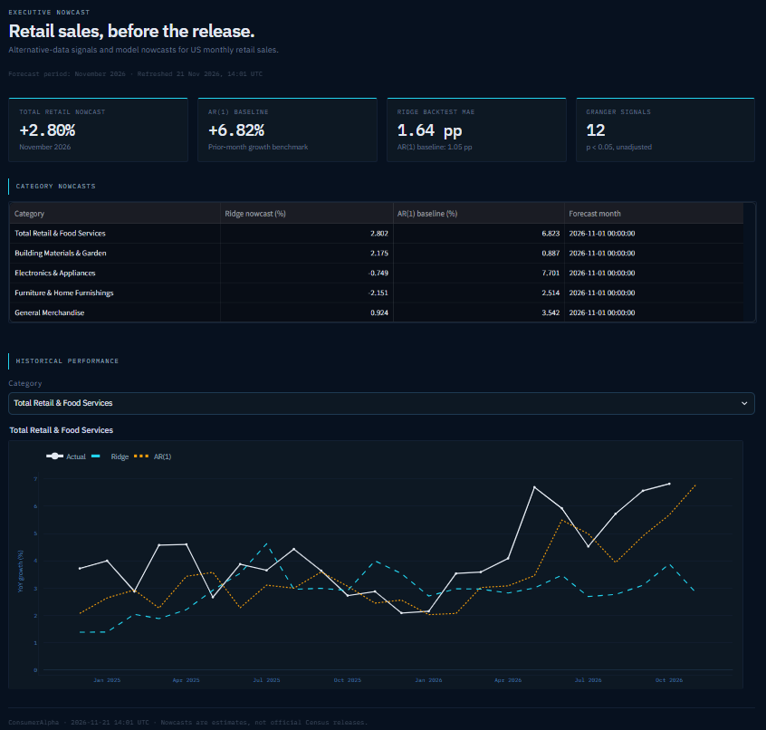

# ConsumerAlpha
### Alternative-Data-Driven Retail Sales Nowcasting

<p align="center">
  <a href="https://consumeralpha.streamlit.app/">
    
  </a>
</p>

**ConsumerAlpha** is an alternative-data-driven retail sales nowcasting project that explores whether consumer behaviour signals from online searches, Reddit discussions, financial markets, and macroeconomic indicators can help anticipate monthly US retail sales trends.

The project combines data engineering, time-series analysis, statistical diagnostics, and machine learning into an automated pipeline, with an interactive dashboard for exploring predictions and model performance.

**[Live Dashboard](https://consumeralpha.streamlit.app/)**

---

## Dashboard Preview

### Executive Nowcast


### Signal Attribution


### Backtest Diagnostics


---

## What It Does

1. Collects alternative and traditional economic indicators from multiple sources.
2. Aggregates high-frequency signals into monthly features.
3. Examines leading relationships using stationarity tests and Granger causality diagnostics.
4. Trains Ridge Regression models to estimate year-over-year retail sales growth.
5. Evaluates predictions against an autoregressive AR(1) baseline using walk-forward backtesting.
6. Displays nowcasts, signal relationships, and model diagnostics through an interactive dashboard.

## Data Sources

| Source | Data |
|---|---|
| FRED / US Census | Retail sales and macroeconomic indicators |
| Google Trends | Purchase intent, deals, electronics, furniture and home improvement searches |
| Reddit / Arctic Shift | Retail discussions, post volumes and sentiment |
| Yahoo Finance | Retail and consumer-sector ETF prices and trading volumes |

## Retail Categories

The project covers five US retail categories:

1. Total Retail & Food Services
2. General Merchandise
3. Furniture & Home Furnishings
4. Electronics & Appliance Stores
5. Building Materials & Garden Equipment

## Tech Stack

| Area | Technologies |
|---|---|
| Language | Python |
| Data Collection | FRED API, Google Trends, Arctic Shift, yfinance |
| Data Processing | Pandas, NumPy |
| Data Warehouse | PostgreSQL, Neon |
| Data Transformation | dbt |
| Statistical Analysis | Statsmodels |
| Machine Learning | Scikit-learn, Ridge Regression |
| Dashboard | Streamlit, Plotly |
| Automation | GitHub Actions |

## Pipeline Architecture

```text
             DATA SOURCES
                   |
       +-----------+-----------+
       |           |           |
      FRED       Google      Reddit
     /Census     Trends     Arctic Shift
       |           |           |
       +-----------+-----------+
                   |
              Yahoo Finance
                   |
                   v
          PYTHON INGESTION
                   |
                   v
             POSTGRESQL
                   |
                   v
                 dbt
                   |
          +--------+--------+
          |                 |
       Staging          Intermediate
                            |
                            v
                          Marts
                            |
              +-------------+-------------+
              |             |             |
           Granger        Ridge         AR(1)
         Diagnostics    Backtesting    Baseline
              |             |             |
              +-------------+-------------+
                            |
                            v
                  STREAMLIT DASHBOARD
```

## Model Evaluation

Ridge Regression is evaluated against an AR(1) autoregressive baseline using an expanding-window, walk-forward backtesting approach.

The latest backtest used:

- 47 usable historical observations per category.
- 23 backtest months per category.
- Five time-series cross-validation folds for model selection.
- Standardisation and median imputation within the modelling pipeline.

**Current results:** Ridge Regression underperformed the AR(1) baseline across all five retail categories in the evaluated backtest window.

This is an important finding: the alternative-data features have not yet demonstrated consistent predictive improvement over a simple autoregressive benchmark.

The dashboard presents both models so their performance can be compared transparently.

## Signal Analysis

The project uses Augmented Dickey-Fuller (ADF) tests and Granger causality tests to investigate relationships between alternative-data features and retail sales growth.

The latest diagnostic run produced 12 statistically significant results out of 80 tests at an unadjusted p-value threshold of 0.05.

These results are exploratory. P-values are not adjusted for multiple comparisons or lag selection, and Granger predictability does not establish causation.

## Automation & Deployment

The data pipeline is automated using GitHub Actions.

The scheduled workflow:

1. Collects incremental data from configured sources.
2. Loads observations into PostgreSQL.
3. Runs dbt transformations and data tests.
4. Generates Granger diagnostics.
5. Trains and evaluates the forecasting models.
6. Generates the latest nowcasts.

The database is hosted on Neon, while the interactive dashboard is deployed through Streamlit Community Cloud.

The dashboard refreshes its database queries periodically, while new forecasts are generated by the scheduled pipeline.

## Project Structure

```text
consumeralpha/
│
├── .github/
│   └── workflows/
│       └── weekly_pipeline.yml
│
├── ingestion/
│   ├── fetch_fred_census.py
│   ├── fetch_trends.py
│   ├── fetch_reddit.py
│   ├── fetch_market.py
│   ├── db.py
│   └── run_all.py
│
├── dbt_project/
│   ├── models/
│   │   ├── staging/
│   │   ├── intermediate/
│   │   └── marts/
│   └── dbt_project.yml
│
├── modeling/
│   ├── stationarity_granger.py
│   └── train_backtest.py
│
├── dashboard/
│   └── app.py
│
├── assets/
│   ├── executive-nowcast.png
│   ├── signal-attribution.png
│   └── backtest-diagnostics.png
│
├── generate_forecast.py
├── requirements.txt
└── README.md
```

## Limitations & Future Work

> Improve predictive performance relative to the AR(1) baseline.
> Investigate feature selection and alternative forecasting models.
> Improve alignment between partial-month nowcast features and full-month training data.
> Incorporate publication timing and data availability more rigorously to reduce look-ahead bias.
> Improve ingestion reliability through retries and data-quality checks.
> Expand historical observations and evaluate model stability over longer periods.

## Running Locally

Clone the repository:

```bash
git clone https://github.com/YOUR_USERNAME/consumeralpha.git
cd consumeralpha
```

Create and activate a virtual environment:

```bash
python -m venv .venv
.venv\Scripts\activate
```

Install dependencies:

```bash
pip install -r requirements.txt
```

Configure your environment variables in a `.env` file using `.env.example` as a reference.

Run the dashboard:

```bash
streamlit run dashboard/app.py
```

The dashboard requires access to a PostgreSQL database populated with the project's transformed data.

---
